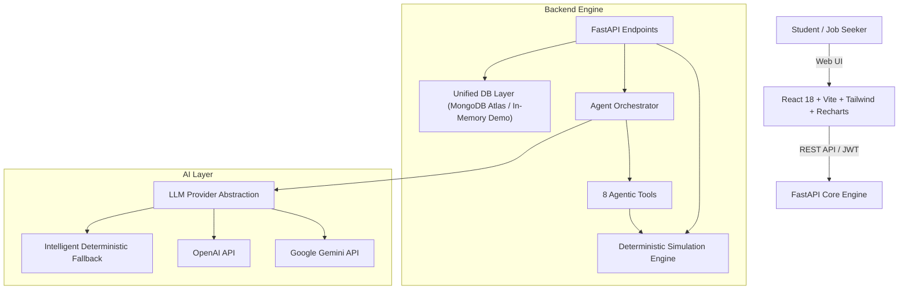

# CareerTwin AI
> **Simulate Your Future. Build Your Career.**

[](https://opensource.org/licenses/MIT)
[](https://fastapi.tiangolo.com)
[](https://react.dev)
[](https://tailwindcss.com)
[](https://sdgs.un.org/goals/goal4)
[](https://sdgs.un.org/goals/goal8)

---

## 🌟 Executive Summary

**CareerTwin AI** is an advanced Agentic AI-powered digital career twin and career simulation platform designed for engineering students, fresh graduates, and career changers. Traditional career platforms provide generic, static job listings or static curriculum roadmaps. They never answer the critical question: *"What happens if I pivot my learning decisions today?"*

CareerTwin AI models each individual as an evolving **Digital Career Twin** (technical proficiencies on a 0–5 scale, soft skills, completed projects, and career goals). Using a **transparent, deterministic career simulation engine** paired with a **tool-calling Python AI agent**, users can simulate alternative career trajectories, compare learning scenarios side-by-side, uncover high-priority competency gaps, and execute adaptive week-by-week roadmaps.

---

## 🎯 United Nations SDG Alignment
- **SDG 4 (Quality Education - Target 4.4):** Substantially increase the number of youth and adults who have relevant skills, including technical and vocational skills, for employment and decent jobs.
- **SDG 8 (Decent Work & Economic Growth - Target 8.6):** Substantially reduce the proportion of youth not in employment, education, or training through data-driven career guidance.

---

## 🏛️ System Architecture



---

## 🧠 The 8 Agentic AI Tools

The AI assistant is not a generic conversational chatbot. It is a Python tool-calling agent with 8 specialized tools:

1. `analyze_user_profile()`: Deeply inspects the digital career twin, education, strengths, and multi-track career compatibility.
2. `calculate_skill_gaps()`: Evaluates current vs target proficiencies, assigning High, Medium, or Low priorities.
3. `calculate_career_readiness()`: Computes the exact weighted readiness score (0–100%) using transparent importance weights.
4. `simulate_career_path()`: Runs hypothetical What-If learning experiments and projects readiness uplifts.
5. `compare_career_scenarios()`: Evaluates alternative learning decisions side-by-side (e.g. AI vs Cybersecurity).
6. `generate_learning_roadmap()`: Constructs an adaptive, week-by-week milestone schedule targeting skill gaps.
7. `update_digital_twin()`: Updates verified proficiencies only when supported by verifiable milestone proof.
8. `recommend_projects()`: Recommends high-impact capstone portfolio projects targeting missing competencies.

---

## 📐 Deterministic Simulation Engine Formula

To maintain strict scientific and ethical integrity, CareerTwin AI avoids opaque black-box predictions. Career readiness is calculated deterministically:

$$\text{Readiness Score} = \frac{\sum (\text{User Skill Proficiency} \times \text{Skill Importance})}{\sum (\text{Required Skill Importance})} \times 20$$

- **Proficiency Scale:** $0.0$ to $5.0$
- **Skill Importance:** $1$ (Foundational) to $5$ (Critical Core)
- **Output:** Normalized $0\%$ to $100\%$ scale

---

## 🚀 Supported Industry Career Tracks

1. **AI/ML Engineer** (High Growth, +38% demand)
2. **Cybersecurity Engineer** (Critical Demand, +32% demand)
3. **Data Scientist** (High Demand, +35% demand)
4. **Software Developer** (Stable High, +25% demand)
5. **Cloud Engineer** (High Demand, +30% demand)
6. **Data Engineer** (High Demand, +31% demand)

---

## 🎬 Hackathon Demonstration Script (9-Scene Walkthrough)

- **Scene 1 (Initialization):** Click **"1-Click Demo as Alex"** on the landing page or login. Instantly logs in as Alex (2nd Year Computer Science student).
- **Scene 2 (Digital Twin Dashboard):** Inspect Alex's Digital Twin. See live readiness (AI/ML: 41.5%, Cyber: 32.0%), multi-axis radar chart, and top competency gaps.
- **Scene 3 (Career Explorer):** Explore requirements across 6 structured career tracks. Click **"Compare Any Two Careers"** to see side-by-side metrics.
- **Scene 4 (Diagnostic Gap Analysis):** Open the **Skill Gaps** tab. Uncover why Machine Learning (+3.0 gap) and PyTorch (+4.0 gap) are critical bottlenecks.
- **Scene 5 (What-If Simulation Lab):** Open the **Simulation Lab**. Add hypothetical learning actions (e.g. +2.0 Machine Learning, +2.0 SQL). Click **"Run What-If Simulation"**.
- **Scene 6 (Scenario Comparison):** Click **"Compare Scenario A vs B"** to see AI Track (+13.5 pts) vs Cybersecurity Track (+8.5 pts).
- **Scene 7 (Agentic AI Mentor):** Open the **AI Mentor**. Ask: *"Which career suits my current skills best?"* Watch the agent invoke `analyze_user_profile()` and provide grounded guidance.
- **Scene 8 (Adaptive Roadmap):** Open the **Roadmap** tab. Review the 8-week structured execution schedule.
- **Scene 9 (Twin Evolution):** Check a milestone task checkbox and submit verified project evidence. Watch the Digital Twin evolve with +0.3 proficiency boost on the **Twin Evolution** timeline.

---

## 🛠️ Quick Start & Installation

### Option 1: Run Locally (Fastest)

#### Backend
```bash
cd backend
python -m pip install -r requirements.txt
python -m uvicorn app.main:app --reload --port 8000
```
Backend API docs available at: `http://localhost:8000/docs`

#### Frontend
```bash
cd frontend
npm install
npm run dev
```
Frontend accessible at: `http://localhost:5173`

---

### Option 2: Docker Compose

```bash
docker-compose up --build
```
- Frontend: `http://localhost:5173`
- Backend API: `http://localhost:8000`

---

## 🧪 Testing

Run backend test suite:
```bash
cd backend
python -m pytest tests -v
```
Integration verification script:
```bash
cd backend
python -u run_tests.py
```
Frontend TypeScript check:
```bash
cd frontend
npm run build
```

---

## 🔒 Security & Reliability
- Zero hardcoded secrets in client-side code
- PBKDF2-HMAC-SHA256 password hashing
- Signed JWT Bearer token authentication
- Resilient In-Memory Demo mode when cloud MongoDB is not configured
- Pydantic v2 input validation on all API endpoints
- CORS whitelist protection
